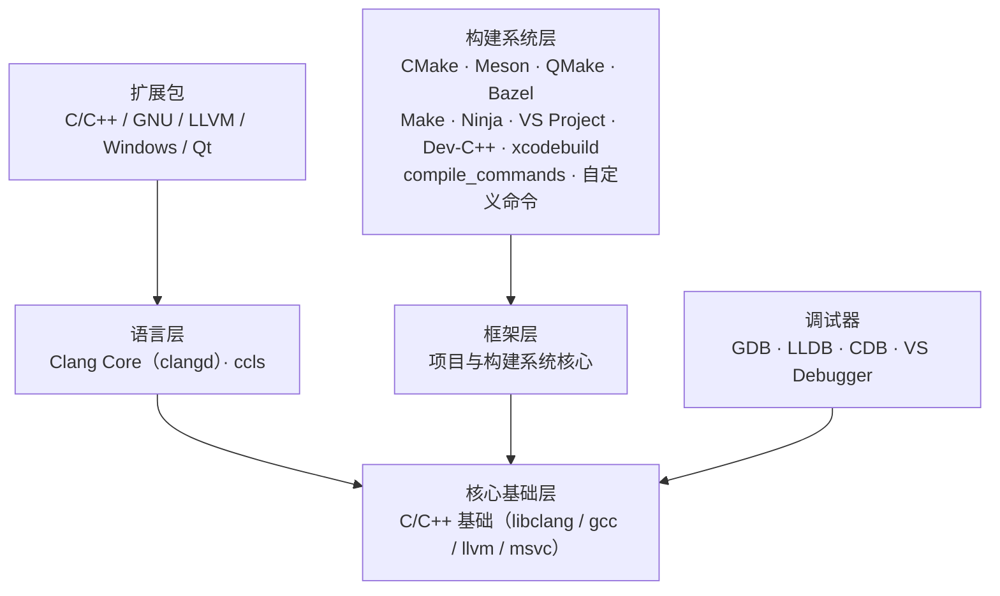

# LightCpp

LightCpp 是一个面向 C/C++ 的轻量级跨平台 IDE。本仓库先把 **插件生态** 这一层落成可执行的东西：
把 `lightcpp.1.md` 规划里的分层、依赖关系、功能清单和扩展包组合，转成机器可读的清单 + 一套能校验、能解析、能生成文档的工具。

> 结论先说：规划不再是一份读完就放下的文档。`plugins/*/plugin.json` 与 `catalog/features.json` 是唯一事实源（SSOT），
> 189 条功能、47 个组件都被结构化登记，任何"某功能没人实现""CMake 忘了装 Ninja""扩展包里混进了业务逻辑"
> 都会被 `lightcpp-pm validate` 直接判红。

## 快速开始

无需任何第三方依赖，Python 3.9+ 即可：

```bash
python tools/lightcpp_pm.py validate                     # 校验清单、依赖、功能覆盖、计划不变量
python tools/lightcpp_pm.py resolve cpp-extension-pack    # 解析安装闭包与安装顺序
python tools/lightcpp_pm.py info clang-core               # 查看单个插件的依赖 / 功能集
python tools/lightcpp_pm.py graph --format mermaid        # 输出分层依赖图
python tools/lightcpp_pm.py coverage                      # 功能覆盖统计
python tools/lightcpp_pm.py engines                       # 互斥引擎组（clangd / ccls）
python tools/lightcpp_pm.py docs --check                  # 检查生成文档是否过期
python -m unittest discover -s tests -v                   # 24 个用例
```

`resolve` 的典型输出：

```
| # | 插件       | 层级                    | 版本  | 来源                  |
| 1 | cpp-base   | 核心基础层              | 0.1.0 | 由 cmake 引入         |
| 2 | build-core | 项目与构建系统核心框架  | 0.1.0 | 由 cmake 引入         |
| 3 | cmake      | 具体项目 / 构建系统支持 | 0.1.0 | 直接安装              |
| 4 | ninja      | 具体项目 / 构建系统支持 | 0.1.0 | 自动连带安装（cmake） |
```

安装 CMake 自动带出 Ninja、装 Dev-C++ 项目自动带出 Make —— 这些规划里的条款不是注释，是被测试守住的规则。

## 目录结构

| 路径 | 作用 |
| --- | --- |
| `plugins/<id>/plugin.json` | 插件清单：层级、强依赖、推荐/自动安装、功能集、贡献点、激活事件 |
| `catalog/features.json` | 189 条功能目录，按 12 个域、40 个功能集组织，标注归属插件与状态 |
| `catalog/invariants.json` | 规划中的硬性条款（如"Dev-C++ 强依赖 Make""CMake 连带 Ninja"），逐条自动校验 |
| `schemas/plugin.schema.json` | 插件清单的 JSON Schema |
| `tools/lightcpp_pm.py` | 校验 / 解析 / 依赖图 / 功能矩阵 / 文档生成 |
| `tests/test_pm.py` | 真实仓库回归 + 合成仓库的异常分支测试 |
| `docs/` | 架构说明、规划追溯表、插件开发指南，以及自动生成的清单与功能目录 |

## 分层



- **核心层** 只有 `cpp-base`：语法高亮 + 编译器接入 + 调试底层，是整个生态的强依赖。
- **语言层** 是 `clang-core`（clangd 引擎）与 `ccls`：二者共存但同一项目互斥启用。
- **框架层** 是 `build-core`：项目模型、任务调度、配置/工具链/执行/诊断/高级特性全部由它定义，具体行为取决于当前激活的构建系统插件。
- **构建系统层** 全部强依赖 `cpp-base` + `build-core`。
- **扩展包** 零业务逻辑，只声明依赖。

## 关键规则

| 规则 | 落地方式 |
| --- | --- |
| 所有构建系统插件强依赖基础插件与构建核心 | `catalog/invariants.json` 的 `layerDependency` 规则 |
| 装 CMake / Meson 自动连带 Ninja | `recommends.autoInstall`，`resolve` 自动带入 |
| Dev-C++ 项目额外强依赖 Make | 硬依赖 + 不变量校验 |
| 扩展包不写业务逻辑 | Schema 禁止 `contributes`，校验器报 `E017` |
| clangd 与 ccls 共存但互斥启用 | `contributes.lsp.exclusiveGroup`，`resolve` 提示运行时只启用其一 |
| 单文件格式化走 clangd，项目级走 clang-format | `clang.format.single` / `clang.format.project` 两条功能登记 |
| 汇编仅 x86 / Arm | `asm` 插件声明 `architectures`，并登记限制说明 |
| 远程构建暂不支持 | 功能状态标为 `planned`，不计入 v0.1 验收 |

## 已知限制与规划中项

- **远程构建**：`planned`，v0.1 不提供入口。
- **内置终端**：规划中即标注"目前有问题"，功能状态 `known-issue`，v0.1 以外部终端 + Shell 集成兜底。
- **汇编**：仅 x86 系与 Arm 系，其他架构不提供高亮与编译。
- **宿主体**：本仓库当前阶段只到"清单 + 工具链"，插件加载器、贡献点注册、UI 宿主在后续里程碑实现。

## 路线图

| 里程碑 | 内容 | 状态 |
| --- | --- | --- |
| v0.1 | 插件生态 SSOT：清单、功能目录、不变量、解析器、文档生成、CI | 本分支已完成 |
| v0.2 | 插件宿主运行时：加载/激活、贡献点注册（languages / buildSystems / debuggers / lsp） | 计划中 |
| v0.3 | 构建首个可用闭环：CMake + Ninja + compile_commands + clangd 索引 | 计划中 |
| v0.4 | 调试闭环：GDB / LLDB DAP 适配，断点与变量视图 | 计划中 |
| v0.5 | 市场与扩展包一键安装 | 计划中 |

## 许可

GPL-3.0，见 [LICENSE](LICENSE)。
